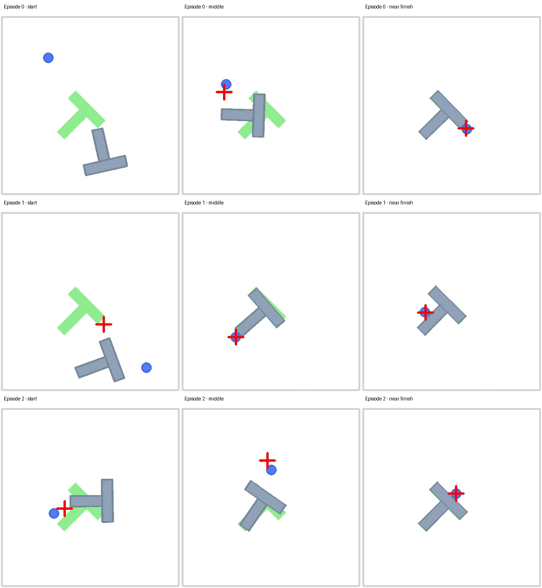
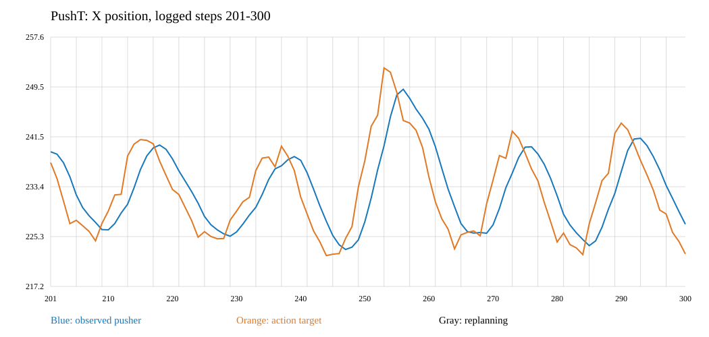

[English](README.md) | [简体中文](README.zh-CN.md)

# Diffusion Policy + PushT 复现与分析

## 1. 项目概述

这是一个基于 Hugging Face LeRobot，在 **PushT 环境中复现与分析预训练
Diffusion Policy** 的小规模学习项目。我通过这个项目理解推理流程，完成仿真评估、
动作执行分块对照，并检查 GPU 执行和重复运行的一致性。

**我没有提出 Diffusion Policy 算法，也没有训练原始预训练模型。** 本仓库整理已有
实验及其局限，作为可核查的本科机器人学习项目展示材料。



图片来自三次已记录的仿真 episode。中英文共用视频：
[基线成功案例](results/pusht-first-experiment-20261013/videos/eval_episode_0.mp4)、
[4 步失败案例](results/dp-steps4-5ep/videos/eval_episode_0.mp4)、
[8 步失败案例](results/dp-steps8-5ep/videos/eval_episode_3.mp4)。
它们均为本地实验录像，不是上游演示视频。

## 2. 上游模型与依赖

- 框架：[LeRobot 0.3.3](https://github.com/huggingface/lerobot/tree/v0.3.3)。
- 环境：[gym-pusht 0.1.5](https://github.com/huggingface/gym-pusht)、Gymnasium 0.29.1。
- 预训练模型：[lerobot/diffusion_pusht](https://huggingface.co/lerobot/diffusion_pusht)，
  固定 revision 为 `84a7c23178445c6bbf7e1a884ff497017910f653`。
- 已记录的运行环境：WSL Ubuntu、Python 3.12.13、PyTorch 2.7.1+cu128、
  torchvision 0.22.1+cu128、diffusers 0.35.1、torchcodec 0.5；
  NVIDIA GeForce RTX 5060 Laptop GPU。

[历史依赖快照](requirements-lock.txt)与[预检记录](results/environment.json)
保留了当时的环境信息。选择 LeRobot 0.3.3 是为了匹配旧模型中存储在策略内部的
归一化结构；评估包装器强制 `strict=True` 加载，并拒绝回退到 CPU。
这不意味着新版 LeRobot 也兼容。仓库不包含约 1.05 GB 的权重、虚拟环境或上游源码树。

## 3. 个人工作

- 搭建并检查预训练模型的 GPU 仿真评估流程。
- 完成已有的小规模评估，对比 `n_action_steps=4` 与 `8`。
- 使用项目本地包装器检查严格加载、CUDA 设备位置、首步观测与动作、动作队列行为、
  奖励及显存使用情况。
- 阅读观测预处理、DDPM 采样、动作生成与队列、评估循环和环境 step 源码，记录数据流。
- 比较普通固定 seed 运行与启用 PyTorch/cuDNN 确定性设置后的运行。

本项目主要在 ChatGPT 辅助下推进，结合了上游 LeRobot 组件和项目本地评估脚本；
实验与整理过程中，部分代码和文档在 AI 辅助下新增或修改。本次整理补充了可移植启动脚本、
修正后的轨迹绘图、离线结果检查、中英文文档及文件来源记录。
详见[文件来源与修改说明](notes/provenance.md)和[上游署名](THIRD_PARTY_NOTICES.md)。

## 4. 实验与结果

### 4.1 实验动机

我最初希望理解视觉观测如何变成动作，以及策略为什么只执行生成动作序列的一部分就重新规划。
观看 PushT 视频时，我注意到推手有时似乎已偏离预期路线，却仍继续执行队列中的动作。
因此，我假设将 `n_action_steps` 从 8 减为 4，可能让策略更早利用最新观测、及时纠正偏差，
从而提高成功率。这促使我围绕动作执行长度与重规划频率开展以下对照。

### 4.2 已记录的评估

下表直接由已有 `eval_info.json` 计算，没有重新评估。两个对照组均使用
episode seed 1000–1004、horizon 16、两帧观测和 100 步 DDPM 去噪。
基线使用 seed 1000–1002。

| 运行记录 | 动作执行步数 | 回合数 | 成功数 | 成功率（%） | 平均最大奖励 | 评估耗时（秒） |
| --- | --- | --- | --- | --- | --- | --- |
| pusht-first-experiment-20261013 | 8 | 3 | 3 | 100.0 | 1.000000 | 101.505 |
| dp-steps8-5ep | 8 | 5 | 3 | 60.0 | 0.996139 | 183.962 |
| dp-steps4-5ep | 4 | 5 | 1 | 20.0 | 0.962637 | 459.651 |

数据来源：[基线](results/pusht-first-experiment-20261013/eval_info.json)、
[8 步组](results/dp-steps8-5ep/eval_info.json)、
[4 步组](results/dp-steps4-5ep/eval_info.json)。
[summary.csv](results/summary.csv)列出全部 13 次已有运行，包括额外检查和失败记录；
上表不是将不同实验合并得到的成功率。

4 步组成功 1/5、8 步组成功 3/5，没有支持我最初关于更频繁重规划可能提高成功率的假设。
这只是每组 5 个 episode、每种配置各一批的探索性结果，**不能证明 8 步普遍优于 4 步**。
4 步组耗时更长，同时受到采样更频繁与 episode 长度不同的影响，不能作为严格的推理延迟基准。
累计奖励也受 episode 长度影响，不能单独用来判断任务是否完成。

### 4.3 重复运行与 GPU 证据

两次普通固定 seed、4 步、单 episode 运行（`dp-repro-a/b`）均成功，但 action/state
轨迹不同，调用次数分别为 153 和 154。启用确定性设置后（`dp-det-a/b`），
两次均成功、各调用 165 次，action/state JSONL 文件逐字节一致。
奖励**并非完全一致**：最大绝对差为 `3.3306690738754696e-16`。
这只支持有限的同机重复运行观察，不能证明整个流程逐位确定。
普通运行的轨迹差异促使我进一步检查扩散采样的随机性、种子设置与 GPU 确定性配置；
现有记录仍不能确定最初差异的唯一来源。
详见[计算得到的对照记录](results/reproducibility.json)及归档日志。

基线的 [GPU 记录](results/pusht-first-experiment-20261013/gpu_evidence.json)
包含严格加载成功、561 次 CUDA 动作调用、PyTorch peak allocated 3327.67 MiB
和 peak reserved 3344.00 MiB。PyTorch 显存统计与整块 GPU 的 `nvidia-smi`
采样口径不同，均不能直接视为所有机器的资源需求。

## 5. 关键观察

- 图像进入 CUDA 策略前变为 `[1,3,96,96]` 的 float32 张量，推手状态形状为 `[1,2]`。
- DDPM 生成 horizon 为 16 的动作序列；策略将 4 或 8 个动作放入队列，每个环境 step
  返回一个 `[1,2]` 目标位置。观测每步更新，但只有动作队列清空后才重新进行扩散采样。
- 较短分块使重规划更频繁，却没有在这批小样本中提高成功率。普通 CUDA rollout
  仅固定 seed 也没有得到完全相同的轨迹。
- 部分失败运行中，我注意到推手反复折返或接近目标后仍继续推动。这让我对动作分块衔接与
  目标附近的控制行为产生疑问，但现有证据不足以确定原因。
- 轨迹图展示推手位置与动作目标，不包含物体完整位姿或接触力，可以辅助观察执行行为，
  但不足以确定失败的因果机制。

这次实验让我开始区分假设与实测结果、轨迹差异与原因解释，并认识到控制实验变量的重要性。
少量成功率和视频不足以支持对策略性能的普遍结论。



此图在整理时根据已有记录重新生成，不是新增 rollout。
实现细节见中英文共用的[源码阅读笔记](notes/source-reading.md)。

## 6. 环境配置与复现

### 6.1 无需模型，检查归档结果

在仓库根目录执行。只需 Python 3.12+；下列命令仅使用标准库，不启动仿真或下载：

```bash
python3 scripts/summarize_results.py
python3 scripts/compare_traces.py results/dp-repro-a results/dp-repro-b
python3 scripts/compare_traces.py results/dp-det-a results/dp-det-b
python3 scripts/check_repository.py
```

根据已有轨迹重新生成坐标标注正确的图像时，请选择新的输出路径；绘图脚本拒绝覆盖文件：

```bash
mkdir -p runs
python3 scripts/plot_trace.py \
  results/dp-trace-steps4-seed1000/action_step_trace.jsonl \
  runs/pusher_x.svg --axis x
```

### 6.2 重建评估环境

使用已安装 NVIDIA 驱动的 WSL/Linux 和支持 CUDA 的 PyTorch。准备好 `uv` 后，
以下命令创建独立环境并安装历史版本。这会下载数 GB 文件，**本次整理未执行这些安装命令**：

```bash
uv python install 3.12.13
uv venv --python 3.12.13 .venv
uv pip install --python .venv/bin/python \
  torch==2.7.1+cu128 torchvision==0.22.1+cu128 \
  --index-url https://download.pytorch.org/whl/cu128
uv pip install --python .venv/bin/python -r requirements-lock.txt \
  --extra-index-url https://download.pytorch.org/whl/cu128
uv pip check --python .venv/bin/python
```

该快照不是重新解析生成的锁文件，也不能保证将来仍能下载所有 wheel。
本次整理检查了已有环境，但没有测试全新安装。评估无需下载 PushT 训练数据集。

### 6.3 获取模型并运行评估

如果已有模型，将 `MODEL_DIR` 指向现有模型目录即可。否则，可选择执行以下命令，
仅下载固定版本的模型配置和权重：

```bash
.venv/bin/python - <<'PY'
from huggingface_hub import snapshot_download
snapshot_download(
    repo_id="lerobot/diffusion_pusht",
    revision="84a7c23178445c6bbf7e1a884ff497017910f653",
    allow_patterns=["config.json", "model.safetensors"],
    local_dir="model",
)
PY
export MODEL_DIR="$PWD/model"
.venv/bin/python scripts/verify_model.py "$MODEL_DIR"
```

权重预期 SHA256：
`995d14d35db57d95c35ad9704c3d79c8612b7bc45f3877e5c46c2cdc516856a8`。
校验脚本检查权重大小、哈希和配置文件是否存在。原本地配置还显式设置了
`device=cuda` 与 `use_amp=false`；启动脚本也会明确传入这两个设置。

下列命令供手动复现，**不代表新增实验结果**。运行名称必须未被使用。
输出写入被 Git 忽略的 `runs/`，保留归档的 `results/`：

```bash
bash scripts/run_eval_action_steps.sh repeat-steps8 5 8
bash scripts/run_eval_action_steps.sh repeat-steps4 5 4
bash scripts/run_eval_deterministic.sh repeat-det-a 1 4
bash scripts/run_eval_deterministic.sh repeat-det-b 1 4
```

启动脚本统一使用 CUDA、AMP=false、batch size 1、初始 seed 1000 和离线模型加载，
并拒绝覆盖已有输出目录。可通过 `PYTHON` 覆盖默认的 `.venv/bin/python`。
运行耗时取决于硬件；改变动作执行分块不仅改变重规划频率，也改变扩散采样随机数的消耗顺序。

## 7. 局限与致谢

本项目没有训练、微调、新算法、真实机器人部署或统计上稳健的 benchmark。
原计划中的每步重规划（1 步）对照没有对应结果，因此不列为已完成工作。
各次运行的独立脚本快照与依赖冻结记录不完整，当前包装器可能包含后来加入的记录功能。
历史多 episode 运行的 `reward_trace.json` 只保留最后一个 episode 的奖励，
动作轨迹没有 episode ID；整理后的包装器为未来运行额外保存分 episode 奖励文件。

本次完成了基本语法、链接、指标、来源、忽略规则及文件检查，但没有进行全新安装或新增 rollout。
详见[检查报告](notes/validation.md)。中英文 README 的代码块和表格数据一致，
共用图片、视频和结果文件。

算法贡献归于 [Diffusion Policy 原作者](https://diffusion-policy.cs.columbia.edu/)，
预训练模型、框架和环境归于各自上游维护者。
[第三方声明](THIRD_PARTY_NOTICES.md)说明了署名与许可证范围。
